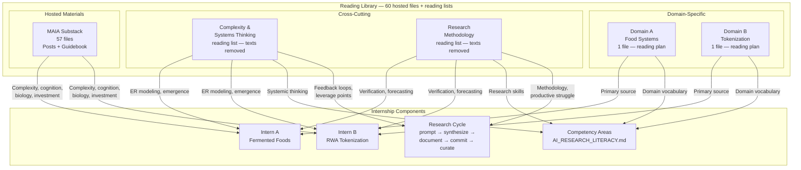

# Library Structure

**Diagram type:** flowchart — shows the reading library's hosted folders and curated reading lists, their file counts, key resources, and how they map to internship domains and competency areas. Serves as the reference architecture for the library.

The library hosts our own MAIA materials. The domain and cross-cutting full texts were removed for copyright compliance (2026-10-17) and remain as curated reading lists in [`Library/INDEX.md`](../../Internship/Library/INDEX.md). Use this diagram to understand which folder to browse for your current research phase.

**Cross-references:**
- [`Library/INDEX.md`](../../Internship/Library/INDEX.md) — Full file listing with relevance annotations
- [`flowchart-program-architecture.md`](flowchart-program-architecture.md) — How the library fits into the overall program
- [`AI_RESEARCH_LITERACY.md`](../../Internship/AI_RESEARCH_LITERACY.md) — The 8 competency areas each folder supports
